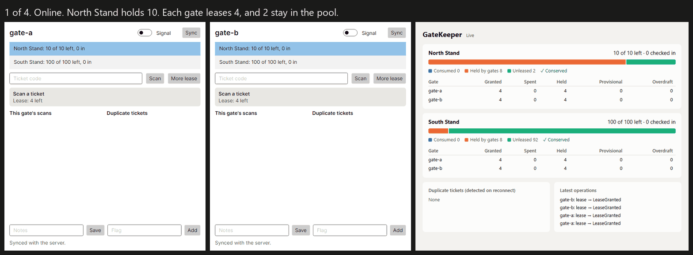

# Leeway

**Business rules that hold, even without signal.**

Leeway extends the .NET Foundation's [Datasync Community Toolkit](https://github.com/CommunityToolkit/Datasync) so that offline apps can keep business rules such as "a venue never overfills", even with every device offline. It adds per-field merges, escrow-backed limits, and a deterministic simulator that tests all of it under partitions, clock skew, and duplicated or reordered sync.

> **Status: early, and [not ready for production](#honest-limits). Nothing is on NuGet.** Milestones M0 to M6 are complete: the merge logic, simulator, Datasync integration, Roslyn tooling, and a demo all work and are tested.

## Demo

GateKeeper is event check-in at venue gates with bad signal. Two gates go offline, spend their leases, and reconnect. The stand never overfills, and a ticket used at both gates is flagged.



These are captured frames from an end-to-end test, not a screen recording. [How to run it yourself](docs/walkthroughs/m6.md).

## The code

```csharp
public class Zone : OfflineEntity
{
    [Escrow(Min = 0, Lease = 10)] public int RemainingCapacity { get; set; }
    [Counter]                     public int CheckIns { get; set; }
    [LastWriterWins]              public string? Notes { get; set; }
}

// With no signal at all. These methods are generated from the attributes:
SpendResult result = await client.TrySpendRemainingCapacityAsync("north", 1);
// Confirmed: within this device's lease, and guaranteed.
// Provisional: beyond it, and the server decides on reconnect.

await client.AddCheckInsAsync("north", 1);
await client.SetNotesAsync("north", "Turnstile 3 jammed");

await client.SyncAsync();

// And the analyzer warns on this, with a code fix to add [Escrow] or [Counter]:
someEntity.Stock--;   // LEE001
```

## Status

"Done" means a command proves it. Requires the .NET 10 SDK.

| Milestone | State | Proving command | Last result |
|---|---|---|---|
| All tests | CI (Linux), and locally on Windows | `dotnet test --solution Leeway.slnx -c Release` | 171 of 171 pass |
| **M0** Datasync spike | Done | `dotnet test --project tests/Leeway.Integration.Tests` (the spike itself became GateKeeper) | See M3 |
| **M1** `Leeway.Core` | Done | `dotnet test --project tests/Leeway.Property.Tests` | 35 of 35 pass |
| **M2** Simulator and mutants | Done | `dotnet run --project mutants/Leeway.Mutants -c Release -- catch` | 18 of 18 caught |
| **M3** Escrow end to end | Done | `dotnet test --project tests/Leeway.Integration.Tests` | 66 of 66 pass |
| **M4** Per-field merging | Done | Same | Same |
| **M5** Generator and analyzer | Done | `dotnet test --project tests/Leeway.Analyzers.Tests` | 37 of 37 pass, plus 14 of 14 for the generator |
| Real NuGet packages | CI (Linux), and locally on Windows | `python scripts/package-check.py` | `PACKAGE CHECK PASSED` |
| Adapter protections | Locally on Windows | `python scripts/adapter-sabotage.py` | 8 of 8 caught |
| **M6** GateKeeper demo | Exit check met | `dotnet test --project tests/GateKeeper.Desktop.Tests` | 8 of 8 pass |
| **M6** Demo with real processes (Windows) | Locally | `powershell -ExecutionPolicy Bypass -File scripts/m6-demo.ps1` | `M6 DEMO PASSED` |

Tests have not been run on macOS, where CI only builds the sample. The real desktop window has only been run on Windows.
Walkthroughs with full output: [M0](docs/walkthroughs/m0.md), [M1](docs/walkthroughs/m1.md), [M2](docs/walkthroughs/m2.md), [M3](docs/walkthroughs/m3.md), [M4](docs/walkthroughs/m4.md), [M5](docs/walkthroughs/m5.md), [M6](docs/walkthroughs/m6.md).

| Simulation metric | Value |
|---|---|
| Longest run on the correct code | 200,000 seeded runs, no failures, locally and in nightly CI from a random seed |
| In the test suite | 10,000 seeded runs |
| Mutant catch rate | 18 of 18 |
| Shrunk regressions | 18 |
| Bugs found in the correct code | 3, all since fixed ([details](docs/walkthroughs/m2.md)) |

## What Datasync does that shapes this design

Reading the source and testing it turned up behaviour in Datasync 10.1.2 that drove the design. All of it is pinned by tests and
explained in the [integration map](docs/design/datasync-integration.md), and Leeway handles each case.

- **A push that times out reports success**, with nothing sent and the change still queued (C24, in 10.1.2).
- **The write after a conflict resolver's merge is unconditional**, so a concurrent update can be silently lost (C10).
- **A poor signal alone can leave one device in a conflict with itself**, when the server applied a write but the response never arrived (C12, C25).
- **On a millisecond-precision store such as SQLite, a row sharing the sync token's millisecond is never pulled** (C19).

Two are filed upstream: the maintainer has fixed both [#578](https://github.com/CommunityToolkit/Datasync/issues/578) and [#579](https://github.com/CommunityToolkit/Datasync/issues/579), though not in a release yet. As a result, [ADR-0012](docs/DECISIONS.md) chooses an append-only operation log with merging done on the server, rather than a client conflict resolver alone.

## Honest limits

What Leeway cannot guarantee is as important as what it can.

- **Some rules cannot be guaranteed offline.** Each rule will be labelled as guaranteed offline, detected on reconnect, or requires a connection.
  A ticket scanned at two offline gates can only be *detected* on reconnect.
- **A device that never returns still holds its lease.** That quota is stranded until an admin writes it off, and if the device was only offline, its spends can then break the rule. They are reported, not hidden ([ADR-0005](docs/DECISIONS.md)).
- **A hybrid logical clock limits the damage from clock skew.** It cannot know which of two concurrent edits a person meant to win.
- **Only SQLite with one server process is tested.** Datasync's own docs advise against SQLite for production services, so **Leeway is not ready for production servers** ([ADR-0003](docs/DECISIONS.md)).
- **There is no device authentication.** A device is whoever it claims to be, so an application must authenticate devices, or one could spend from another's lease.
- **A modified client can cheat.** The offline guarantee assumes the wallet code runs as written. A dishonest device shows up as an overdraft.
- **Nothing is pruned.** The operation table, outbox, and set tombstones grow without limit.
- **A device's provisional spends are not first come, first served.** They reach the server in arbitrary order.
- **Deleting entities is not implemented,** and there is no operation spanning several entities.

## Repository

| Path | Contents |
|---|---|
| `src/` | `Leeway.Core`, the Datasync client and server adapters, the simulator, the generator, and the analyzer |
| `samples/` | GateKeeper: server, dashboard, and Avalonia desktop app |
| `tests/` | Unit, property, snapshot, analyzer, integration, and UI tests |
| `mutants/` | Deliberately broken implementations that measure the simulator |
| `docs/` | [Product](docs/PRODUCT.md), [architecture](docs/ARCHITECTURE.md), [decisions](docs/DECISIONS.md), [roadmap](docs/ROADMAP.md), [risks](docs/RISKS.md), [progress](docs/PROGRESS.md) |

## AI-assistance disclosure

This project is built with substantial AI assistance. Claude (Anthropic), through Claude Code, wrote the code, tests, and documentation so far under a maintainer's brief.
Claims here are meant to be checked: each comes with a command to run. Commits are authored by the maintainer, who is responsible for them, so this notice rather than commit metadata is the record of AI involvement.

## License

[MIT](LICENSE). Samples use only free, open source components. Building the Avalonia sample sends anonymous build telemetry unless `AVALONIA_TELEMETRY_OPTOUT=1` is set ([ADR-0011](docs/DECISIONS.md)).
