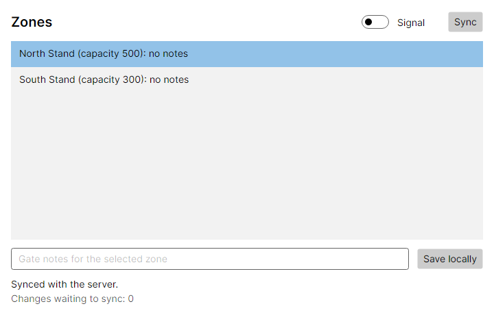
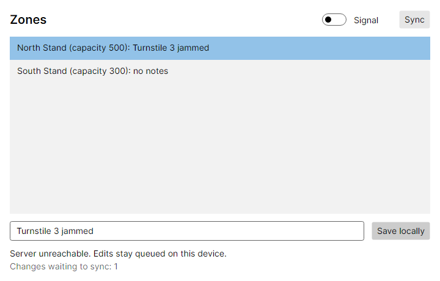
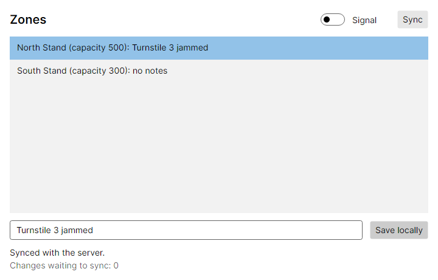
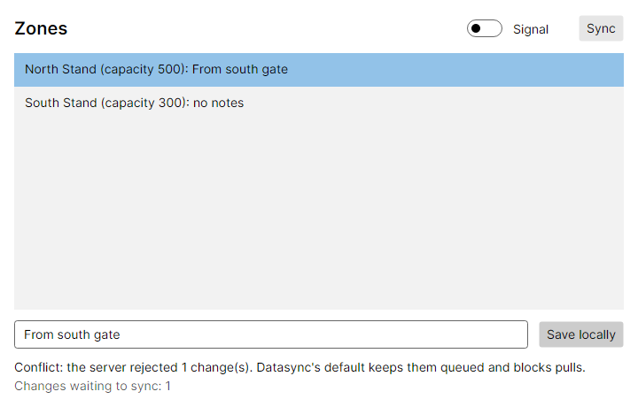

# M0 walkthrough: Datasync spike

**Exit check:** Demo: edit offline, reconnect, sync; `docs/design/datasync-integration.md` complete.

**Result:** Met locally on Windows 11 with SDK 10.0.403. **CI has not run, so by the project's rule M0 is not yet done.**

## Run it yourself

```
dotnet build Leeway.slnx
dotnet test --solution Leeway.slnx
powershell -ExecutionPolicy Bypass -File scripts/m0-demo.ps1
```

To try it by hand, run these in two terminals, then use the **Signal** switch or stop the server:

```
dotnet run --project samples/GateKeeper.Server
dotnet run --project samples/GateKeeper.Desktop
```

## The demo, with nothing simulated

`scripts/m0-demo.ps1` runs the real server as its own process and the real window, drives the window through Windows UI Automation, and goes offline by killing the server process. Output from the last run:

```
[1] Start the server process on http://127.0.0.1:5180
    server pid 24368
[2] Open the north gate and sync
    status : Synced with the server.
    zones  : North Stand (capacity 500): no notes | South Stand (capacity 300): no notes
[3] Kill the server process (pid 24368). The port now refuses connections.
[4] Edit notes with no server, and save locally
    status : Saved locally. Waiting to sync.
    pending: Changes waiting to sync: 1
    zones  : North Stand (capacity 500): Turnstile 3 jammed | South Stand (capacity 300): no notes
[5] Press Sync while offline
    status : Server unreachable. Edits stay queued on this device.
    pending: Changes waiting to sync: 1
[6] Restart the server process (same database) and press Sync
    server pid 12452
    status : Synced with the server.
    pending: Changes waiting to sync: 0
[7] Open a brand-new south gate: does it receive the edit from the server?
    status : Synced with the server.
    zones  : North Stand (capacity 500): Turnstile 3 jammed | South Stand (capacity 300): no notes

M0 DEMO PASSED: edit offline, reconnect, sync.
```

Window captures from this script are `assets/m0-live-*.png`. **Known cosmetic flaw:** they are cropped at the right and bottom on this scaled display. The text above is the proof.

## The cross-platform version

`tests/GateKeeper.Desktop.Tests` drives the real window with real key and pointer input through Avalonia's headless platform, against the real server app on a real socket. Stopping the server really refuses connections. This is what CI will run.

| Online | Edited offline |
|---|---|
|  |  |

| Reconnected | Default conflict: why Leeway exists |
|---|---|
|  |  |

The fourth frame is the baseline. Two gates edit the same row offline. With Datasync's default, the second gate's change is rejected and stays queued, and pulls for that table stop until something resolves it.

To check these tests can fail, I temporarily removed the push from `GateStore.SyncAsync`: all of the tests at that time (3 of 3) failed. The change was reverted.

## Test results

Release configuration, from a fresh `git clone`, the same commands as CI:

```
$ dotnet build Leeway.slnx -c Release --no-restore
Build succeeded.    0 Error(s)

$ dotnet test --solution Leeway.slnx -c Release --no-build
GateKeeper.Desktop.Tests.dll (net10.0|x64) passed
Leeway.Analyzers.Tests.dll (net10.0|x64) passed
Leeway.Core.Tests.dll (net10.0|x64) passed
Leeway.Generators.Tests.dll (net10.0|x64) passed
Leeway.Integration.Tests.dll (net10.0|x64) passed
Leeway.Property.Tests.dll (net10.0|x64) passed
Leeway.Simulation.Tests.dll (net10.0|x64) passed
 total: 42
 failed: 0
 succeeded: 42
 skipped: 0
```

Of these, 35 are meaningful: 31 Datasync probes and 4 UI tests. The other 7 are scaffold and toolchain checks. They prove the tooling runs, and no Leeway feature exists yet.

Cross-RID builds of both samples for `linux-x64`, `osx-arm64`, and `win-x64` succeed on Windows. That shows packages restore and compile for those platforms, **not** that the apps run there.

## The flaky test that found the most important bug

Worth recording, because of how close it came to being dismissed. The first three full runs after the suite went green were fail, pass, pass, and then eight more passed. I ran the UI tests in parallel to add load, and kept the output:

| Stage | Tests run under load | Failures | Cause |
|---|---|---|---|
| Before any fix | 96 | 1 | `DatasyncException: There are still pending operations`: the push had reported success |
| After fixing `GateStore` | 192 | 1 | My new test's 2 s timeout was too tight for the machine |
| After retrying in the test | 160 | 2 | A retry timed out after the server had applied the write, so the next one conflicted with the device's own write |
| Final | 192 | 0 | The UI test no longer races a short real timeout. Probes C24 and C25 pin the behaviour deterministically |

- **C24:** a timeout is an `OperationCanceledException`, which the `ActionBlock` running the push treats as cooperative cancellation. So `PushResult.IsSuccessful` is true with the operation still queued. On no signal, push throws, but on a bad signal it claims success, and bad signal is exactly Leeway's target environment.
- **C25:** if the server applied the write before the client gave up, the retry gets a 412 against the device's own write. Under the default resolver, the device is stuck with no other writer involved.

The fix in the sample covers only the first: `GateStore.SyncAsync` checks the queue instead of trusting `IsSuccessful`. **C25 remains in the M0 sample by design.** It is the baseline, and ADR-0012's idempotent operations are the chosen answer. For the third row, the mixed test log is consistent with this explanation but does not prove it alone. C25 proves the mechanism.

## Problems met in the toolchain

| Problem | Resolution |
|---|---|
| Datasync pulls in a native SQLite with a high-severity advisory, which failed the build | Pinned to a clean version, and C22 checks the version really loaded (ADR-0008) |
| Verify 33 fails the build unless a licence fee status is declared | Stayed on 32.0.1, the last MIT release (ADR-0009) |
| `Avalonia.Headless.XUnit` fails on xUnit v3 4.x despite its declared range | Used `HeadlessUnitTestSession` directly (ADR-0010) |
| My first snapshot test passed without comparing anything, because an empty generator produces no snapshot | A test-only generator now emits real source, and a `.verified.cs` is committed |
| A clean-clone run failed: the Roslyn analyzer harness downloads reference assemblies at test time, and a partial download fails the test | Tests compile against the running runtime instead. With the cache deleted, five runs passed and fetched no packages (ADR-0010) |

## Not done or not proven

- **CI has never run.** The workflow file only passes a YAML parse. Linux and macOS test runs are unverified, including Skia and fonts on Linux.
- **The demo video or GIF** belongs to M6.
- `GateKeeper.Dashboard` does not exist yet (M6). Nightly simulation CI arrives with the simulator in M2.
- **No upstream issues have been filed.** Proposals are listed in the integration map.
- **ADR-0012 and ADR-0013 are accepted but not built.** No Leeway integration code exists, and the op-table approach has only been proven at the transport level (C14).
