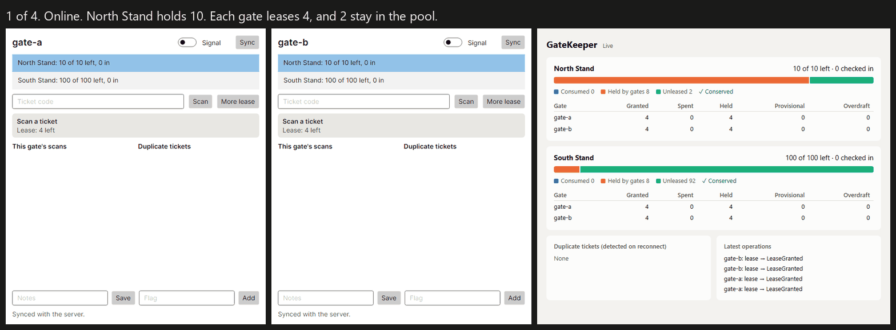

# M6 walkthrough: GateKeeper demo

**Exit check:** a published README demo and walkthrough, showing gates offline, the dashboard, and reconnecting.

**Result:** Met. The write-up is in `docs/writeup.md`. It is in this repository only, and has not been posted anywhere else.



The GIF is a sequence of frames captured from the test named below, so each frame shows a state that test asserts. **It is not a screen recording.** The gates are real windows rendered by Avalonia's headless platform, and the dashboard is a real page in a headless browser. To rebuild it: `python scripts/make-demo-gif.py`.

## Run it yourself

With the real windows, by hand, in three terminals:

```
dotnet run --project samples/GateKeeper.Server --urls http://localhost:5180
dotnet run --project samples/GateKeeper.Dashboard --urls http://localhost:5181
dotnet run --project samples/GateKeeper.Desktop -- --gate=gate-a --db=gate-a.db
```

Open `http://localhost:5181`, and start a second gate with `--gate=gate-b --db=gate-b.db`. Tickets are `T-1001` to `T-1030` for North Stand, and `S-2001` to `S-2030` for South Stand. Use the **Signal** switch or stop the server to go offline.

## The story, in tests

```
dotnet test --project tests/GateKeeper.Desktop.Tests
```

`Two_offline_gates_cannot_overfill_a_zone_and_a_duplicate_ticket_is_flagged`, with real input against the real server and dashboard on real sockets. Stopping the server really refuses connections.

| Step | What happens | Guarantee class |
|---|---|---|
| Online | North Stand holds 10. Each gate leases 4, and 2 stay in the pool | |
| Offline | Each gate admits 4, guaranteed, with no signal | Guaranteed offline |
| Offline | Gate A's fifth scan and gate B's fifth and sixth are provisional | Requires a connection |
| Offline | `T-1001` is scanned at both gates, and neither can know | Detected on reconnect |
| Reconnect | The pool's 2 places fund 2 of the 3 provisional scans, and the third person is turned away | |
| Result | 10 of 10 used, never over. Conserved. `T-1001` flagged at both gates and on the dashboard | |

## With separate processes

```
powershell -ExecutionPolicy Bypass -File scripts/m6-demo.ps1
```

This runs the real server, dashboard, and two gate windows as separate processes, drives the windows with Windows UI Automation, and kills the server process to go offline. From the last run:

```
[3] Kill the server process (pid 29464). The port now refuses connections.
[4] Each gate spends its lease offline, and T-1001 is scanned at both.
    gate-a: ADMIT T-1001: guaranteed, within this gate's lease.
    ...
    gate-a: PROVISIONAL T-1005: beyond the lease. The server decides on reconnect.
    gate-b: ADMIT T-1001: guaranteed, within this gate's lease.
    ...
[5] Restart the server (same database), and sync both gates.
[6] Check the result on the dashboard, over HTTP.
    North Stand: 10 of 10 used, conserved: True
    Duplicates : T-1001 at gate-a, gate-b

M6 DEMO PASSED: the zone never overfilled, and the duplicate was flagged.
```

## What the demo found

- **The order of a device's provisional spends was arbitrary.** A test assumed `T-1009` would beat `T-1010`, and it passed by luck until it did not. Datasync's queue has no `ORDER BY`, and Leeway's IDs are random. The limit always held, but "who gets in" was not first come, first served. ADR-0018 later fixed this within a device.
- **Looking at the frames found what assertions did not.** The first GIF had a blank dashboard, a stale "provisional" banner after the scan had been settled, and a gate saying "Synced" while offline. All are fixed. The dashboard now renders its first state on the server, and keeps the last known state when the server is down.
- **A headless browser hung and blocked the whole run** by holding output pipes open. The harness now kills the browser's whole process tree on a time limit.
- **Test pooling hid the real speed.** See below.

## Measured speed

The long test runs raised the question, so I measured it, in a throwaway benchmark on this one Windows machine: 60 of each operation over a local server, with SQLite connection pooling on, as in the samples.

| Operation | Typical | Worst seen |
|---|---|---|
| A spend, with no network | 8 to 17 ms | 477 ms |
| A counter edit, with no network | 10 to 19 ms | 201 ms |
| A read | Under 1 ms | 4 ms |
| Syncing 120 operations to a local server | 1.6 s, about 13 ms each | |

So a scan, which makes three writes, takes roughly 30 to 60 ms. **This is a rough figure, not a benchmark suite.** It is one machine and one run. It has no network latency, and the code is not in the repository. Pooling matters a great deal: with it off, a spend took 53 to 59 ms.

## Analyzer's first real use

The samples build with the analyzer and generator on, and produce no warnings. That is weak evidence, because the samples are small and were written by someone who knows the rules.

## Limits

- **The real desktop window has only been run on Windows.** CI builds it for Linux and macOS, and runs the UI tests on Linux in headless form.
- **A scan is several transactions.** A crash between them could leave a spend with no scan. It errs on the safe side, since capacity is spent rather than created, but Leeway has no multi-entity operation.
- **A duplicate costs capacity,** because both gates admitted someone. The venue can end up under capacity, never over.
- **A turned-away scan is discovered late.** A person let through on a provisional scan may already be inside. A venue would have to choose whether to hold them until the signal returns.
- **Ticket validity is only as fresh as the last pull.**
- **The dashboard and `/admin/state` have no authentication.** They are for a demo only.
- **There is no write-off button.** Write-off works in the library and is tested there, but the demo does not show it.
- **MAUI is not built,** as the brief intended for after this milestone.
