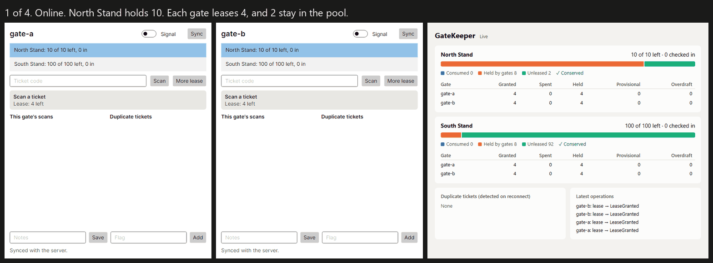

# Business rules that hold, even without signal

A venue has a gate with bad signal, and a stand that holds 500 people. Two staff scan tickets on tablets that can't reach the server. How do you make sure the stand doesn't overfill?

You can't check with the server, because you can't reach it. Letting both gates decide on their own means they can both let in the last person. Most offline frameworks leave this to you, and resolve the fallout afterwards, by which point 503 people are in a stand that holds 500.

Leeway is an open source .NET library that handles this case. It extends the .NET Foundation's [Datasync Community Toolkit](https://github.com/CommunityToolkit/Datasync).



## Lease it first

The idea, escrow, is an old one from database research. Before going offline, each gate leases part of the quantity from the server. A gate with 4 places can admit 4 people with no signal at all, because those places are its alone. Nobody else can spend them, so no conflict is possible.

```csharp
public class Zone : OfflineEntity
{
    [Escrow(Min = 0, Lease = 4)] public int RemainingCapacity { get; set; }
    [Counter]                    public int CheckIns { get; set; }
    [LastWriterWins]             public string? Notes { get; set; }
}

SpendResult result = await client.TrySpendRemainingCapacityAsync("north", 1);
// Confirmed: within this gate's lease, and guaranteed.
// Provisional: beyond it, and the server decides on reconnect.
```

Beyond the lease, the gate can't promise anything, so it says so. A provisional scan goes to the server on reconnect, and is either funded from the unleased pool or rejected.

## Saying what you can't do

Not every rule can hold offline, and I think a library should say which is which. Every Leeway rule is one of three things:

| Class | Example |
|---|---|
| **Guaranteed offline** | The stand never overfills |
| **Detected on reconnect** | One ticket scanned at two offline gates |
| **Requires a connection** | Spending beyond the lease |

No amount of engineering lets two disconnected gates know about each other. So a ticket used at both is flagged on reconnect, not prevented. It also uses up two places, which is the safe direction: the stand can end up under capacity, never over.

## What the simulator found

Merging is easy to get subtly wrong, so Leeway has a deterministic simulator. It runs devices and a server through partitions, crashes, clock skew, and lost, duplicated, and reordered messages, and then checks that the rules held. Any failure shrinks to a minimal schedule.

Its first run failed about a third of the time, and every unit test and property test was passing. It found three real bugs:

1. **A lost increment.** After the server acknowledged an add, but before the device pulled the new row, the device's own view was missing that add. So the next add computed a lower total, and the merge threw it away.
2. **A clock correction that reordered writes**, in 9 runs out of 10,000.
3. **The fix for that bug, which had the same problem,** in 9 runs out of 50,000.

To check that the simulator can catch mistakes, I also gave it 18 deliberately broken implementations. It caught all 18. That number says less than it seems to: those are 18 mistakes somebody thought of, and most are caught right away. It's the three real bugs that convinced me.

## What the underlying toolkit does

Building on Datasync meant testing what it really does, and I pinned that behaviour with tests. A few results surprised me, and I reported them upstream. The maintainer fixed each one quickly, some within hours:

- A push that timed out reported success, with nothing sent ([#578](https://github.com/CommunityToolkit/Datasync/issues/578)).
- A conflict resolver's merged write was unconditional, so it could silently lose a concurrent update ([#579](https://github.com/CommunityToolkit/Datasync/issues/579)).
- A race in the sync lock, which turned up once in CI ([#596](https://github.com/CommunityToolkit/Datasync/issues/596)).

The second one shaped the design. Instead of merging rows on the client, a Leeway device sends small operations with unique IDs, and the server merges them in a transaction. Retries are harmless, and devices cannot overwrite each other's work.

## What it can't do yet

Leeway isn't ready for production, and I'd rather say so here than have you find out later.

- **Only SQLite and MySQL are tested on the server.** Several servers on one MySQL database work in tests, but all writes go through one lock, and failover is untested.
- **Authentication is a hook you fill in.** The server won't start until you decide, but it takes an identity from your app rather than issuing credentials.
- **A modified client can cheat.** The offline guarantee assumes the wallet code runs as written. Cheating shows up as an overdraft, after the fact.
- **A device that never comes back keeps its lease** until an admin writes it off. If it was only offline, its spends can then break the limit, and they are reported.
- **Some state grows forever.** Operation logs can be pruned safely, but set tombstones can't yet, because a device might stay offline indefinitely.
- **The tests can miss things.** Hundreds of thousands of clean simulator runs don't prove there are no bugs, and the simulator tests a model of the transport, not the adapters.

## Try it

Nothing is on NuGet yet. The code, the demo, and a command that proves each claim are at [github.com/JoshBlazer/leeway](https://github.com/JoshBlazer/leeway). If you build offline field apps in .NET, I'd like to hear what's missing.

*This project was built with substantial AI assistance: Claude, through Claude Code, wrote the code, tests, and docs under my direction, and this post was drafted the same way.*
